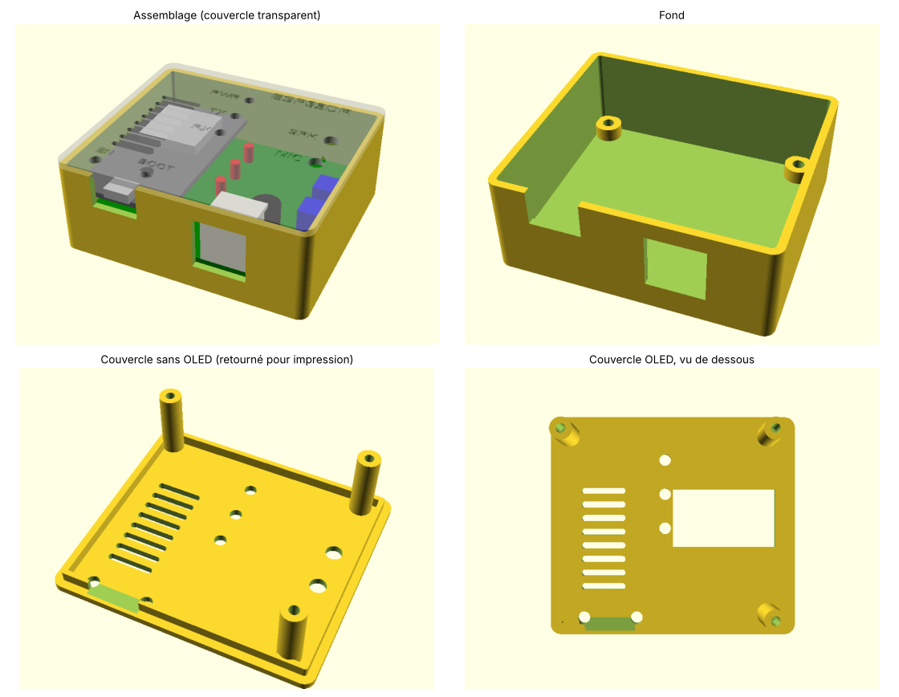
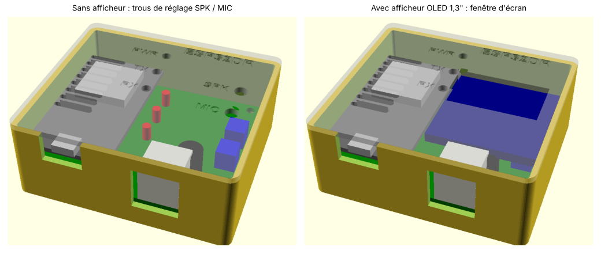
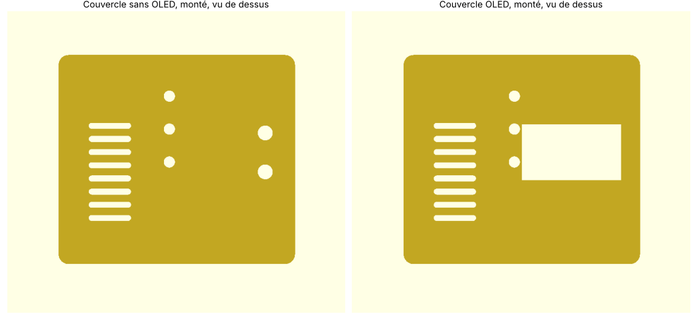

# Boîtier ESP32DR Simple

Boîtier en deux pièces (fond + couvercle) pour la carte **ESP32DR Simple** du projet
[ESP32APRS_Audio](https://github.com/nakhonthai/ESP32APRS_Audio#esp32dr-simple).

La carte mesure 64 × 58 mm. Elle porte un ESP32 DevKit (30 broches), une prise RJ11 6 contacts vers le
poste radio, trois LED (PWR, TX, RX), deux ajustables de niveau audio (SPK et MIC) et, en option,
un écran OLED 1,3" (SH1106). Toutes les positions utilisées par le boîtier (contour, trous de fixation,
USB, RJ11, LED, ajustables, connecteur de l'OLED) ont été relevées sur les Gerber officiels
[`doc/Gerber_ESP32DR_Simple.zip`](https://github.com/nakhonthai/ESP32APRS_Audio/blob/master/doc/Gerber_ESP32DR_Simple.zip).

## Versions avec et sans afficheur

Le **fond est le même** dans les deux cas : il est prévu assez large pour l'écran OLED, qui dépasse
de la carte côté droit. Seul le **couvercle** change.

### Sans afficheur

Le couvercle porte deux trous de 4,5 mm placés au-dessus des ajustables **SPK** (niveau reçu) et **MIC**
(niveau émis). On règle les niveaux audio au petit tournevis **sans ouvrir le boîtier**.

### Avec afficheur OLED 1,3"

Le couvercle porte une fenêtre de 30 × 17 mm au-dessus de la zone active de l'écran. L'écran
recouvre alors les deux ajustables : **réglez SPK et MIC avant de fermer le boîtier**
(ou ouvrez-le pour retoucher les niveaux).

> La position de la fenêtre est calculée à partir du connecteur de l'écran sur la carte et des dimensions
> habituelles d'un module SH1106 1,3" ; elle n'a pas encore été vérifiée sur un écran réel. Si votre module
> diffère, ajustez `oled_c` (centre) et `oled_t` (taille) dans le fichier `.scad`.

Les deux couvercles ont les mêmes trous pour les trois LED, les mêmes fentes d'aération au-dessus de l'ESP32
et les inscriptions gravées (PWR, TX, RX, ESP32DR ; SPK et MIC sur la version sans afficheur).

## Quel fichier imprimer ?

Il y a deux hauteurs de boîtier selon la façon dont l'ESP32 DevKit est monté sur la carte :
**enfiché sur des barrettes femelles** (comme sur la photo du projet d'origine, ESP32 démontable) ou
**soudé directement** sur la carte (boîtier plus bas).

| Montage de l'ESP32 | Fond | Couvercle sans afficheur | Couvercle avec afficheur |
|---|---|---|---|
| Sur barrettes femelles | [`esp32dr_fond.stl`](stl/esp32dr_fond.stl) | [`esp32dr_couvercle_sans_oled.stl`](stl/esp32dr_couvercle_sans_oled.stl) | [`esp32dr_couvercle_oled.stl`](stl/esp32dr_couvercle_oled.stl) |
| Soudé sur la carte | [`esp32dr_fond_esp32_soude.stl`](stl/esp32dr_fond_esp32_soude.stl) | [`esp32dr_couvercle_sans_oled_esp32_soude.stl`](stl/esp32dr_couvercle_sans_oled_esp32_soude.stl) | [`esp32dr_couvercle_oled_esp32_soude.stl`](stl/esp32dr_couvercle_oled_esp32_soude.stl) |

| | Sur barrettes | Soudé |
|---|---|---|
| Dimensions extérieures | 71,5 × 63,5 × 28,6 mm | 71,5 × 63,5 × 24,6 mm |
| Hauteur libre au-dessus de la carte | 19 mm | 15 mm |

Le fond et le couvercle d'une même ligne vont ensemble : ne pas mélanger les deux hauteurs.

## Impression

- Aucun support nécessaire. Les STL sont déjà orientés : le fond à plat, le couvercle **face extérieure
  sur le plateau** (les inscriptions gravées apparaissent donc à l'envers sur le plateau, c'est normal).
- PLA ou PETG, couche de 0,2 mm, 3 parois, remplissage 15 à 20 %.
- La fenêtre RJ11 du fond est fermée par un pont de 15 mm, qui s'imprime sans support.

## Montage

1. Poser la carte sur les quatre entretoises du fond. Le pion de centrage entre dans le trou de fixation
   situé sous l'ESP32 ; l'USB et le RJ11 se présentent face à leurs ouvertures.
2. Poser le couvercle : sa lèvre s'emboîte dans le fond et ses trois colonnes viennent serrer la carte.
3. Visser par le dessous **3 vis M3 × 12** (tête cylindrique ou bombée). Elles traversent le fond et
   la carte et se taraudent directement dans les colonnes du couvercle.

Les LED sont à environ 19 mm sous le couvercle (15 mm en version soudée). Pour qu'elles soient bien
visibles, soudez-les sur pattes longues afin que leur tête affleure dans les trous du couvercle.

## Personnaliser (`boitier_esp32dr_simple.scad`)

| Paramètre | Rôle | Défaut |
|---|---|---|
| `piece` | `"fond"`, `"couvercle"`, `"assemblage"` (aperçu) ou `"decoupes"` (contrôle 2D) | `"assemblage"` |
| `oled` | couvercle avec fenêtre d'écran au lieu des trous de réglage | `false` |
| `esp_sur_supports` | ESP32 enfiché sur barrettes (`true`) ou soudé (`false`) | `true` |
| `usb_z` | hauteur du centre de la prise USB au-dessus de la carte | 14 / 5,5 mm |
| `h_int` | hauteur libre au-dessus de la carte | 19 / 15 mm |
| `rj_h` | hauteur de l'ouverture RJ11 | 14,5 mm |
| `boutons` | ajoute des trous d'accès aux boutons EN / BOOT de l'ESP32 | `false` |
| `oled_c`, `oled_t` | centre et taille de la fenêtre OLED | [48,26 ; 31] et 30 × 17 mm |
| `aeration`, `gravure` | fentes d'aération et textes gravés | `true` |

À vérifier sur votre carte avant d'imprimer si vos composants diffèrent : hauteur de la prise USB
de votre DevKit (micro-USB ou USB-C), hauteur de la prise RJ11 et position de l'écran OLED.

L'image [`images/controle_ouvertures.png`](images/controle_ouvertures.png) superpose les découpes du
couvercle (magenta : sans afficheur, orange : avec afficheur) au dessin de la carte, pour contrôler
leur alignement.

## Historique

- **v2** : couvercles corrigés (la v1 était exportée en miroir) ; trous EN / BOOT retirés par défaut.
- **v1** : première version.

## Crédits

- Carte ESP32DR Simple : © Somkiat Nakhonthai (HS5TQA), projet
  [ESP32APRS_Audio](https://github.com/nakhonthai/ESP32APRS_Audio), licence GPL-3.0.
- L'image `images/controle_ouvertures.png` contient un tracé de la sérigraphie et des perçages issus
  des Gerber de ce projet ; elle est donc soumise à la licence GPL-3.0 du projet d'origine.
